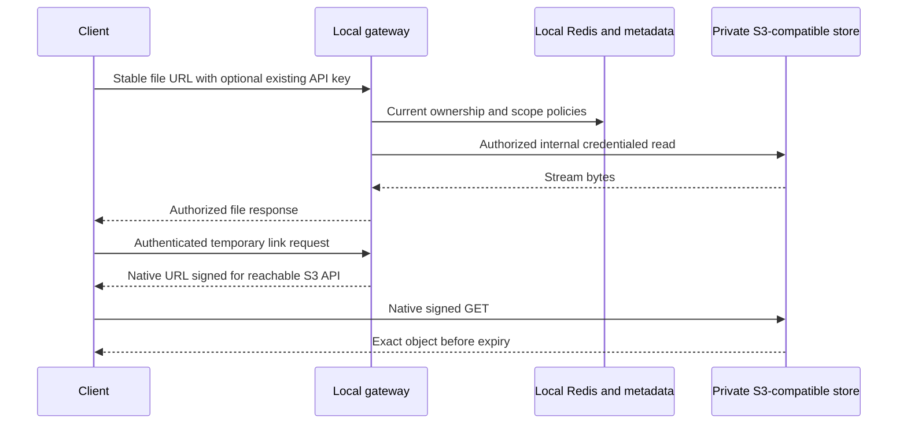

## Context

Pushed baseline `07d332fc6cde11e3e1ce1247f0ac41a16708570a`. File settings originate in `src/groundx/templates/_helpers/services/file.tpl`; ingress helpers render customer file routing. Existing helpers distinguish public and bucket domains, but Cashbot's MinIO constructor currently uses public BaseDomain. Worker/client configuration must change with routing so requests do not loop through the gateway.

## Goals / Non-Goals

Provide the same API-key, policy, cache and native sharing behavior locally. No CloudFront, edge function, cloud identity service, new link token system or vendor storage fork is required.

## Decisions

### Values and generated configuration

Add the following optional values to source values/schema and published mirror. The old deployment remains byte-compatible when fileAccess.enabled is false.

| Value | Default | Purpose |
| --- | --- | --- |
| fileAccess.enabled | false | Enable the local gateway and deployment-readiness gates |
| fileAccess.replicas | 2 | Gateway replicas, independent of store replicas |
| fileAccess.image.repository / name / tag | admin.imageRepository / file-access / chart appVersion | New Cashbot FileAccess image from its normal build workflow, exact digest recorded at release |
| fileAccess.resources | Existing Go API resource pattern | Workload-specific requests/limits recorded in the load run |
| fileAccess.publicUrl | Required when enabled | Existing stable file URL root, routed to gateway |
| fileAccess.trustedOrigins | Empty, at most 32 HTTPS origins | Operator-declared saved-reference aliases in the same storage namespace |
| fileAccess.ingress.hostName | publicUrl hostname | Optional verified origin DNS route and TLS hostname without changing public presentation URLs |
| fileAccess.frontProxyTLSVerified | false | Operator assertion of verified HTTPS termination and encrypted trusted gateway backplane, required before chart enablement |
| fileAccess.tlsSecretName | Required for external ingress when enabled | TLS certificate secret reference |
| fileAccess.storageEndpoint | Required when enabled | Private S3 API URL for workers and gateway reads |
| fileAccess.signingEndpoint | Required when enabled | Native S3 API URL reachable by recipients, signed as delivered |
| fileAccess.storageCredentialsSecretName | Required for native MinIO adapters | Existing credential secret reference, no credentials inline; native AWS S3 may use its ambient credential chain |
| fileAccess.serviceAccount.create / name / annotations | false / existing account / empty | Optional gateway ServiceAccount creation and workload identity, including IRSA role annotation |
| fileAccess.caSecretName | Empty for system trust | Optional custom storage TLS trust reference |
| fileAccess.policyCacheTtlSeconds | 600 | Local policy TTL, not customer sharing expiry |
| fileAccess.mappingCacheTtlSeconds | 3600 | Stable mapping TTL |

The main Cashbot config receives optional upload.storageEndpoint and upload.signingEndpoint, plus fileAccess readiness/cache settings. The private endpoint carries its own scheme/port and CA trust, rather than inheriting the public baseURL SSL flag. Preserve baseURL as the stable public root and existing bucket/region selection. Use a separate storage/signing client configuration rather than replacing signed hosts later. When disabled, derive legacy client configuration exactly as today. When enabled, fail startup if a storage/signing endpoint loops to the delivery gateway, required TLS/trust/secret settings are missing, or private-origin readiness is absent. Do not print secrets.

For ai-server, add uploadStorageEndpoint and uploadPublicRead=false. uploadBaseURL remains the presentation root. The uploader constructs its MinIO client against uploadStorageEndpoint and the matching scheme; existing configurations without it retain legacy behavior. The Python configuration generation must agree with these field names before chart release. The extraction SDK receives storage_endpoint and public_read=False while retaining its presentation settings; custom CA trust uses SSL_CERT_FILE. Enabled public presentation URLs use the publicUrl HTTPS scheme and retain the existing host/path/bucket exactly once. Presentation hosts must match the delivery host; clients upgrade legacy HTTP URLs before adding authentication headers.

Enabled extraction configuration checks the installed `ContainerUploadSettings.model_fields` for both `public_read` and `storage_endpoint` before constructing settings. Older SDKs such as 4.0.7 silently ignore unknown Pydantic fields, so private configuration must fail before client or bucket initialization with a safe compatibility error. Disabled configurations retain their existing constructor path. The compatible published SDK and extract image remain activation gates; rendering alone does not establish runtime compatibility. `.build/bin/verify-extract-private-sdk.py` executes both rendered chart surfaces with the selected installed SDK without network or storage access.

Deploy gateway Deployment/Service using existing Go service/probe patterns, with /health liveness and /readyz database/schema/Redis readiness, with nonpublic database/Redis/store connectivity and a compatible image. Ingress replaces only file delivery routes, preserves exact paths and forwards existing GroundX auth headers. Native signingEndpoint has a separate route directly to the storage S3 API, preserving signed Host/path/query. It uses storage signature verification; neither the S4 web UI login nor GroundX credential headers authenticate that route. Strip GroundX headers before storage requests. A signing endpoint exposed for recipient use is accessible on the intended customer network, not necessarily the public internet.

Raw GET, HEAD, Range and conditional reads reach the gateway before response delivery. Preserve the view=links query for owner-authenticated refreshed X-Ray; its fresh presentation returns 200 JSON without raw ETag/304 or Range semantics. It never uses a buffered Lambda path. Disable any ingress/proxy response caching for document routes. No unsigned storage read is available for protected objects; the gateway still serves known public legacy resources anonymously after opt-in deployment. Repointing the hostname does not require rewriting stored artifact URLs. Unknown document paths are denied, with known static/model routes explicitly preserved.

### Storage readiness

Provision private buckets and credentials first. No worker startup may rewrite existing bucket policies, enable anonymous reads or close access by surprise. Existing anonymous grants must be inventoried and removed by the operator under the deployment's change process after credentialed processing and public gateway compatibility pass. An enabled gateway cannot activate protected policies while any store alias bypass remains.

TLS covers client/gateway and store communications on the deployment's trust boundaries. For protected deployment, require HTTPS on network storage/signing endpoints or explicit verified equivalent encrypted service-mesh transport for internal storage. Kubernetes networking alone is not encryption. A default plaintext MinIO install must configure encrypted transport before protection readiness passes. At-rest encryption is a separate store/storage-volume configuration gate; S3 compatibility alone does not imply encryption. Verify anonymous GET/HEAD denied, credentialed internal GET/PUT/list only as required, and native signed GET/PUT validated with the exact host/path/query. Do not reuse shared account API keys as store credentials.

### Compatibility matrix

| Store | Adapter and endpoint | Required run identity |
| --- | --- | --- |
| AWS S3 | Existing AWS SDK with native presigning | Region, bucket configuration and credential expiry mechanism |
| MinIO | Existing MinIO Go/Python SDK, private S3 API | Exact image digest, chart/operator versions and topology from the test deployment |
| AIStor | Same MinIO-compatible SDK | Customer/deployment release version and exact image digest |
| Red Hat S4 | Same compatible SDK, native Ceph RGW S3 API on port 7480 | rh-aiservices-bu/s4 source 797911cbaa1b44fcaecfdfe69145a6a904ef7463, chart 0.1.0/appVersion 0.3.2, pinned image digest, never latest |

MinIO/AIStor release versions are explicit test inputs recorded before running the suite; support is limited to versions with observed passing evidence. Do not claim universal compatibility. Red Hat S4's web UI is on port 5000 and is not the object API. Its Helm S3 ingress/route defaults disabled and must be explicitly configured for reachable native signing. The upstream chart supports only one S4 replica due to SQLite; two gateway replicas do not make that storage HA. Verify RGW persistence, region/addressing style, deployment encryption and throughput. No vendor code changes are planned.

## Cross-Service Flow

## Risks / Trade-offs

Streaming adds bandwidth and a hop. Size gateway replicas from measured workload; use the [capacity gates](related-changes.md#cashbot-go). Separating the endpoint prevents worker loops but changes generated config and client constructors, so ship all compatible consumers together. S4 is a single-replica store in the pinned chart and needs an explicit availability envelope. Encryption/endpoint reachability must be proven, not inferred.

## Migration Plan

Ship compatible Cashbot/ai-server images, add schema through the existing migration hook, configure private storage/signing endpoints and gateway, then validate all public/default customers before any resource opt-in. Mirror source chart changes and run the full existing Helm gate. Local opt-in requires source backfill, caller authorization and the selected store's exact-version integration. This on-prem release track is independent of hosted cloud S3/ADP activation; other unverified stores remain unadvertised and disabled. Roll back only to a gateway version enforcing active policies; retain private storage and policy records. Return temporary errors rather than reopening opted-in resources.

## Provider References

- [Pinned S4 Helm chart](https://github.com/rh-aiservices-bu/s4/tree/797911cbaa1b44fcaecfdfe69145a6a904ef7463/charts/s4).
- [Pinned S4 deployment documentation](https://github.com/rh-aiservices-bu/s4/blob/797911cbaa1b44fcaecfdfe69145a6a904ef7463/docs/deployment/README.md).

## Presentation memory admission

The default gateway reserves 2 GiB per replica for two concurrent presentations with a 64 MiB input cap. Raw file delivery uses fixed streaming buffers. Local 60 MiB X-Ray presentation verification increased the retained heap approximately 256 MiB and allocated approximately 451 MiB cumulatively per request. The reservation includes transient JSON buffers and concurrency headroom; it is not throughput certification. Operators changing size or concurrency limits must measure pod memory and scheduling requests before activation.

## Ingress host separation and credential scope

Resolve legacy `file.ingress.data.hostName` with the same `tpl` expansion used by the ingress renderer. Compare its case-insensitive hostname with the public delivery hostname and an enabled chart gateway ingress hostname whenever file access is enabled. The public host remains protected when gateway ingress is managed externally; a disabled unused chart ingress hostname does not reserve a delivery host. Reject collisions before rendering. Allow a distinct native signing/store ingress and retain disabled file-access behavior. Storage/signing endpoint loop admission continues to include the public hostname and only an enabled chart gateway ingress hostname, preserving unused disabled-ingress settings.

Keep `groundx.secrets` limited to operator `cluster.secrets`. Add feature credentials through a workload-aware helper using service identities, independent of dependency wait containers. The Go API, file gateway, upload and ingestion workers, summary client, large-file delivery and migration hook need store clients. Layout API, inference and all layout Celery workers and extraction API, agent, download and save workers need store access. Ranker API/inference, summary API/inference, workspace and metrics receive no implicit feature credential. Operator global and per-service secrets remain intact, with duplicate names imported once. Native AWS S3 with an empty feature Secret continues using ambient credentials.

The source consumer boundaries are Cashbot `server/GroundX`, `server/FileAccess`, `server/FileUploadIngest`, `server/ProcessFiles` (the summary-client image), `server/PreProcessTrainFile`, `server/ProcessTrainFile`, `server/QueueTrainFile`, `server/DocumentLayoutWebhook`, `pkg/processor/largefile/runtime.go` and the migration config initializer; ai-server `document/upload.py` and document task modules; and generated `layout-config-py.yaml` and `extract-config-py.yaml`. Workspace config contains no upload settings. Metrics constructs its Redis/metrics handler without a store client. Ranker and summary generated configuration contains no upload settings.

Implement source templates first and mirror exact bytes to `helm`. Add regressions for direct and templated legacy host collisions, custom gateway aliases with managed/external ingress, distinct native routes, disabled legacy routes, retained credential consumers, excluded workloads, global Secret preservation and ambient S3. Run focused Helm tests, both chart render surfaces, the full chart gate and minikube renders. Live transport, image/SDK compatibility and the protected extraction acceptance cases remain separate activation gates.
